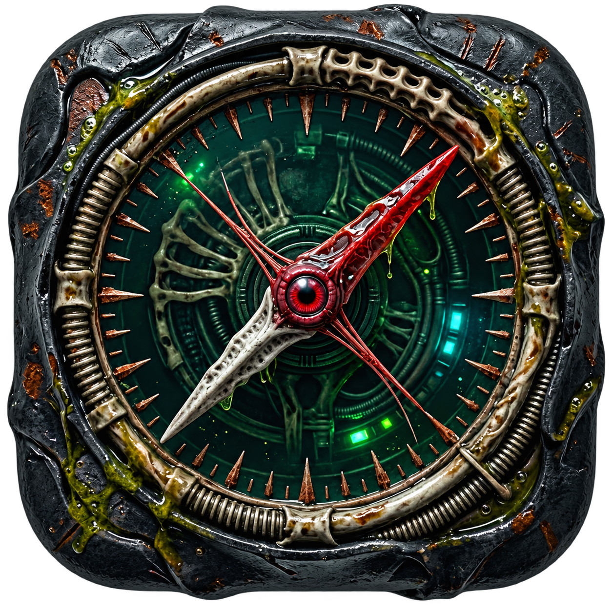
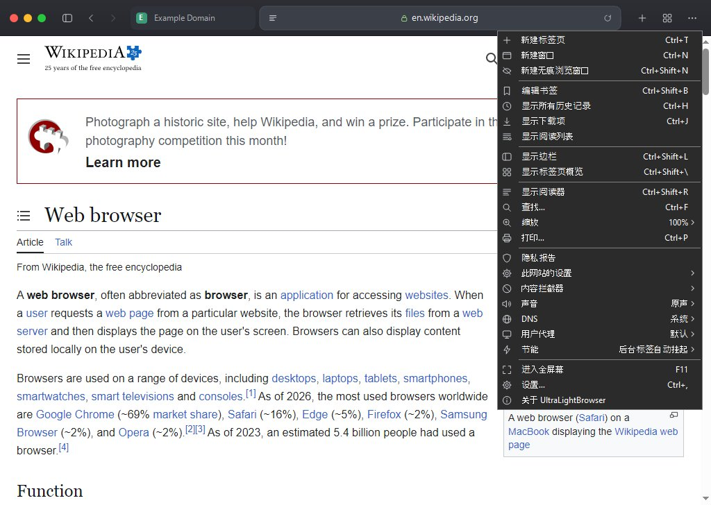

<p align="center">
  
</p>

<h1 align="center">UltraLightBrowser</h1>

<p align="center">轻量、注重隐私的浏览器｜Windows 桌面版 + Android 测试版</p>

<p align="center">
  <a href="https://github.com/Freecode100Year/UltraLightBrowser/releases/latest"></a>
  
  
  <a href="LICENSE"></a>
</p>

<p align="center"></p>

UltraLightBrowser 使用系统 Chromium 内核：Windows 版基于 Microsoft Edge WebView2，Android 版基于 Android System WebView。它把标签页、隐私清理、内容拦截和网络线路整合在一个轻量浏览器中。无需浏览器账号；关闭浏览器时清理网页数据。Windows 与 Android 的功能因平台内核不同而有所区别。

## 版本与平台

| 版本 | 技术 | 适用平台 | 主要特点 |
| --- | --- | --- | --- |
| Windows 桌面版 | Win32、C++20、Edge WebView2 | Windows 10/11 x64 | 扩展程序、用户脚本、内容拦截、阅读器、音频增强和多窗口 |
| Android 测试版 | Java、AndroidX、Android System WebView | Android 8.0 及以上 | Safari 风格底部工具栏、多标签页、网络线路、用户脚本 |

Android 版尚处于测试阶段。它不支持 Chrome / Edge 扩展，也不提供 Windows 版的全部功能。

## 主要功能

- **网络线路**：Windows 和 Android 版内置 Cloudflare WARP，并可使用内置公共线路或添加自己的线路。线路由浏览器内的网络组件处理，不需要把系统其他应用接入代理。
- **断线保护**：我的线路不可用时不会自动改为直连。Windows 版还可设置 WARP 断开时是否阻止联网；Android 版会在 WebView 不支持代理或线路尚未就绪时阻止网页加载。
- **关闭时清理**：关闭浏览器时清除 Cookie、网站数据和缓存。书签、设置等浏览器资料按平台规则保留。
- **内容拦截**：Windows 版内置广告与跟踪请求拦截、广告位隐藏和元素屏蔽。
- **用户脚本**：两种平台均可运行匹配网站的 JavaScript / 油猴脚本；Android 版提供常用 GM 接口子集，兼容性说明见下文。
- **浏览器界面**：采用紧凑的 Safari 风格布局，提供标签页概览、书签或收藏、地址栏和阅读体验优化。

网页流量仍会经过你选择的 WARP 服务或线路服务商。只使用自己信任的网络线路，并在安装扩展或用户脚本前确认其来源。

## Windows 桌面版

Windows 版使用 Edge WebView2 渲染网页，支持多窗口、无痕窗口、书签、阅读列表、阅读器、标签页组、键盘快捷键和下载管理。其他功能包括：

- Chrome / Edge 扩展：加载已解压的扩展，或导入 `.crx` / `.zip` 包。扩展可使用的 API 受 WebView2 支持范围限制。
- 用户脚本：导入 `.user.js` 或普通 JavaScript，支持常用网址规则及 GM 接口。
- 音视频：可选浏览器音频增强、播放诊断，以及需要显卡和驱动支持的视频增强选项。
- macOS Edge 兼容标识：用于网站兼容性测试，不会把 Windows 系统或渲染环境变成 macOS。
- 本地广告与跟踪拦截规则、网页元素隐藏和阅读器。

详细功能、限制及网络说明见 [FULL_VERSION_GUIDE.md](FULL_VERSION_GUIDE.md)。

### 下载 Windows 版

前往 **[GitHub Releases](https://github.com/Freecode100Year/UltraLightBrowser/releases/latest)** 下载最新 Windows x64 版本。需要 Windows 10/11 x64 和 Microsoft Edge WebView2 Runtime（Windows 11 通常已安装）。请以 Release 页面实际提供的文件为准。

## Android 测试版

Android 版面向手机使用，地址栏和浏览器按钮位于屏幕下方，标签页以卡片网格展示。它复用仓库中的 Go 网络组件，通过 AndroidX `ProxyController` 将 WebView 流量送入本机 SOCKS5 代理；不需要 VPN 权限。

- 支持 Cloudflare WARP、内置公共线路、用户添加线路和直接连接模式。
- Android 自定义线路支持 VLESS、Trojan、VMess、Shadowsocks、Hysteria2（`hysteria2://` / `hy2://`）和 TUIC 分享链接；gRPC 是 VLESS / VMess 等线路可选的传输方式。
- WireGuard 支持从文件导入单 Peer 的 wg-quick `.conf`，配置必须包含 DNS，且 DNS 地址要落在 Peer 的 `AllowedIPs` 中。网站 DNS 通过 WireGuard 隧道；Hysteria2、TUIC 和 WireGuard 的服务器域名使用设备 DNS 解析。
- Hysteria2 支持密码和可选 Salamander 混淆；TUIC 支持 UUID、密码、ALPN、拥塞控制和 UDP 转发模式。两者启用 TLS 证书校验，不接受跳过校验的选项。
- 线路订阅支持通用分享链接列表，不支持 Clash YAML 或 WireGuard 配置文件；WireGuard 需逐个导入。
- WebRTC 已禁用；Safe Browsing 和 WebView 使用统计已关闭。
- 从菜单「用户脚本」导入 `.user.js` 或 `.js`，可启用、停用或删除脚本。
- 油猴脚本支持 `@match`、`@include`、`@exclude`、`@run-at` 和 `@noframes` 等常见元数据。
- 提供 `GM_info`、`GM_getValue`、`GM_setValue`、`GM_deleteValue` 和 `GM_addStyle` 等常用接口。
- 普通 `.js` 文件没有匹配元数据，导入时需要填写脚本运行网址。

**Android 版的已知限制：** Android System WebView 不提供 Chrome / Edge 扩展 API，因此不能安装桌面扩展。用户脚本尚不支持 `@require`、`@resource`、脚本菜单及跨域 GM 请求等高级 Tampermonkey 功能。下载、摄像头、麦克风和定位目前也未实现。若设备的 Android System WebView 过旧、不支持代理功能，浏览器会停止网页加载以避免意外直连。

### 构建 Android 版

需要 JDK 17+、Android SDK、Gradle 9 和 Go（版本要求见 `warp/go.mod`）。在仓库根目录运行：

```bash
GRADLE=/path/to/gradle android/build-apk.sh debug
```

生成的 APK 位于 `android/app/build/outputs/apk/debug/`。脚本会为 `arm64-v8a`、`armeabi-v7a` 和 `x86_64` 构建网络组件，并生成各 ABI APK 和通用 APK。更多说明见 [android/README.md](android/README.md)。

## 网络线路

浏览器提供三种连接方式，具体选项因平台版本略有差异：

| 方式 | 说明 |
| --- | --- |
| Cloudflare WARP | 通过 WARP 隧道访问网页。Windows 版支持断线策略设置。 |
| 我的线路 | 使用内置公共线路或导入自己的线路；线路不可用时不回退到直连。 |
| 直接连接 | 不经过浏览器线路，网站会看到当前网络的真实出口地址。 |

桌面版支持 VLESS、Trojan、VMess、Shadowsocks 等线路格式及订阅管理。Android 版另支持 Hysteria2、TUIC、gRPC 传输和单 Peer WireGuard 文件导入；协议与导入限制见上文及 [Android 说明](android/README.md)。网络线路服务商可能看到你访问的网站域名，请谨慎使用第三方线路。

## 用户脚本与扩展安全

扩展程序和用户脚本可以读取或修改它们运行网站的页面内容。只安装来自可信来源的文件。Android 用户脚本保存在应用内，并随网页数据清理策略处理页面数据；用户脚本本身保存在浏览器应用配置中。

## 从源码构建 Windows 版

需要 Windows、Visual Studio 2022（C++ 桌面开发）、CMake 3.25+、NuGet、Rust stable（Cargo）和 Go（版本见 `warp/go.mod`）。

```powershell
.\build-windows.ps1
```

输出位于 `dist\Release\UltraLightBrowser.exe`。也可参考 [FULL_VERSION_GUIDE.md](FULL_VERSION_GUIDE.md) 和 [CONTRIBUTING.md](CONTRIBUTING.md)。

## 项目结构

```text
android/       Android 应用及 APK 构建脚本
src/           Windows 原生浏览器、WebView2 集成与功能模块
ui/            浏览器内置页面与界面资源
warp/          Go 网络组件：WARP、线路协议及本机 SOCKS5 代理
rust/adblock/  广告与跟踪规则引擎
server/        线路服务器辅助脚本
tests/         项目测试
```

## 许可证

本项目使用 [MIT 许可证](LICENSE)。第三方依赖及其许可证信息见 [FULL_VERSION_GUIDE.md](FULL_VERSION_GUIDE.md) 和对应源文件目录。

Safari 是 Apple Inc. 的商标；Microsoft Edge、Android、Cloudflare 和 Dolby 等名称归其各自权利人所有。本项目与这些公司及其产品无隶属或背书关系。
